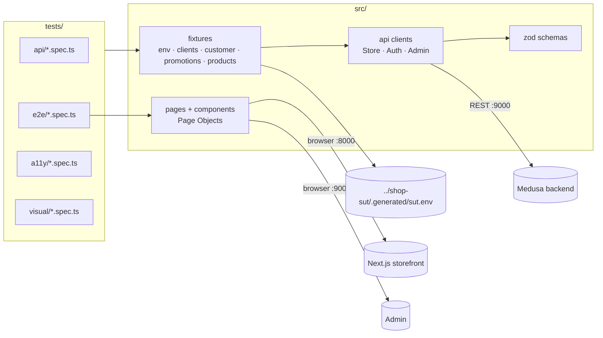

# Shop E2E · Playwright + TypeScript

UI and API test automation for **Medusa**, an open-source commerce platform: storefront, admin and the
Store/Admin REST APIs in one Playwright framework, with visual, accessibility and network checks.

   

## In 30 seconds

- **75 test cases, 121 runs** across Chromium, Firefox, WebKit, Pixel 7 and iPhone 15 emulation: 45 API,
  19 E2E, 7 accessibility/ARIA, 4 visual — full local run **119 passed in 66 s** (2026-10-31).
- Hybrid tests: data is prepared through the Admin API, the action happens in the browser, the result is
  verified through the API — e.g. the UI checkout total must equal the order total in the Admin API.
- **15 real findings in Medusa 2.22.2**, each with a reproduction and a test that encodes the correct
  behaviour — e.g. every rejected checkout action shows *"Minified React error #441"* in production builds.
- Zero flaky tests across repeat runs (Chromium ×5, WebKit ×3); retries are off locally.
- Manual QA package: test plan, smoke checklist, **106 test cases** in CSV for TestRail/Qase (76 linked to
  automated tests, 30 manual-only), three SBTM exploratory sessions with screenshots.

## Live reports

Not published yet: CI and the HTML report on GitHub Pages arrive when the repository is pushed
(see Roadmap). Locally: `npm run report`.

## Architecture



The stand comes from the sibling repository **shop-sut** (`make up`); its contract file supplies URLs,
the publishable key, region IDs and test credentials. Nothing is hard-coded.

## Stack

| Tool | Why |
|---|---|
| Playwright Test 1.64.1 | Three engines, API client in the same runner, fixtures, projects, traces ([ADR-001](docs/adr/ADR-001-playwright.md)) |
| TypeScript 6 (strict, `noUncheckedIndexedAccess`) | Type errors caught before running tests |
| zod 4 | Every API response validated against a schema written from real responses |
| @faker-js/faker 10 | Data seeded from the test title: reproducible failures, unique e-mails and codes |
| @axe-core/playwright 4.14 | WCAG 2.1 A/AA scans with a reviewed baseline |
| ESLint 10 + eslint-plugin-playwright, Prettier, Husky | No fixed waits, no forced clicks, web-first assertions; lint + typecheck on commit |
| Docker (official Playwright image) | Visual baselines rendered on Linux only ([ADR-003](docs/adr/ADR-003-visual-baselines.md)) |

## Quick start

Prerequisites: Node.js ≥ 22.12, Docker with Compose v2, GNU Make. macOS: `brew install node` and Docker Desktop.

```bash
# 1. Start the shop (sibling repository) — writes ../shop-sut/.generated/sut.env
make -C ../shop-sut up && make -C ../shop-sut smoke

# 2. Install
npm ci
npx playwright install --with-deps chromium firefox webkit   # --with-deps only on Linux

# 3. Smoke, then everything
npm run test:smoke
npm test

# 4. Visual tests (Linux image) and the report
npm run test:visual
npm run report
```

If the shop is not running, every command stops with a message that says how to start it.

## Project structure

| Path | Purpose |
|---|---|
| `src/api/` | Typed clients for the Store, Auth and Admin APIs (`raw()` for negative tests, schema-checked calls otherwise) |
| `src/schemas/` | zod schemas of the responses the tests rely on |
| `src/fixtures/` | Test fixtures (env, clients, per-test customer, promotions/products with cleanup), custom assertions, axe helper |
| `src/pages/`, `src/components/` | Page Objects for storefront and admin; components: header, product card, cart summary. No assertions inside |
| `src/data/` | Data factories (seeded faker, unique e-mails/codes, addresses) |
| `src/config/env.ts` | Loads and validates the shop contract file |
| `tests/setup/` | Signs in a customer and the admin through the UI once and saves the browser state |
| `tests/api/` | Catalog, regions, cart, checkout, promotions, auth and access control |
| `tests/e2e/` | Checkout, cart, account, promotions, admin, network control, agent seed |
| `tests/a11y/` | axe-core scans with `baseline.json`; ARIA snapshots |
| `tests/visual/` | Screenshot tests and their Linux baselines |
| `scripts/` | Visual runner for Docker; coverage matrix generator |
| `docs/` | Strategy, coverage matrix, findings, accessibility, ADRs, AI usage |
| `docs/manual/` | Test plan, smoke checklist, `test-cases.csv`, exploratory session sheets |
| `.claude/agents/`, `.mcp.json`, `specs/` | Playwright Test Agents for Claude (planner, generator, healer) |

## Test strategy

Risk-based: checkout and money first. Anything verifiable through the API is tested there; UI tests
cover what only the UI can break and verify outcomes through the API. Full version:
[docs/test-strategy.md](docs/test-strategy.md).

## Coverage

| Area | API | E2E (3 browsers) | Mobile | A11y / ARIA | Visual |
|---|---|---|---|---|---|
| Catalog, product, regions, currency | ✓ | ✓ | ✓ | ✓ | ✓ |
| Cart (quantities, removal, reload, sold out) | ✓ | ✓ | ✓ | ✓ | ✓ |
| Promotions (percentage, fixed, invalid, removal) | ✓ | ✓ | | | |
| Checkout (guest, signed-in, admin verification, idempotency) | ✓ | ✓ | ✓ | ✓ | ✓ |
| Account (register, login, logout, profile, orders) | ✓ | ✓ | ✓ | | |
| Access control (no key, no token, forged token, customer on admin routes) | ✓ | | | | |
| Admin (create product, create promotion) | ✓ | ✓ | | | |
| Network failures visible to the browser | | ✓ | | | |

Per-test detail, generated from the code: [docs/coverage-matrix.md](docs/coverage-matrix.md).
Not covered here: server-side failures between storefront and backend ([ADR-002](docs/adr/ADR-002-network-control.md)).

## CI/CD

Planned for publication: PR checks (lint, typecheck, API + smoke in parallel, trace on failure);
nightly run on 3 browsers × 4 shards with blob reports merged into one HTML report on GitHub Pages;
weekly visual, accessibility, mobile and flaky-hunt runs. Retries are already configured for CI only.

## How-to

| Task | Command |
|---|---|
| One test by title | `npx playwright test -g "guest buys a T-shirt"` |
| By tag | `npm run test:smoke` · `npx playwright test --grep @a11y` |
| One project | `npm run test:api` · `npx playwright test --project=webkit` |
| Debug | `npm run test:ui` or `npx playwright test --debug -g "<title>"`; open a trace with `npx playwright show-trace <trace.zip>` |
| Update visual baselines | `npm run test:visual:update`, review the PNG diff, commit |
| Update the a11y baseline | `A11Y_UPDATE_BASELINE=1 npx playwright test --project=a11y`, then replace each `TODO review` with a finding ID |
| Regenerate the coverage matrix | `npm run coverage:matrix` |
| Add a test | Put setup data in a fixture or factory, actions in a Page Object, assertions in the test; tag it; run it 5 times with `--repeat-each=5` |

## Results and findings

All found on 2026-10-31 against the pinned stand. Details and evidence: [docs/findings.md](docs/findings.md),
[docs/accessibility.md](docs/accessibility.md).

| ID | Finding | Severity |
|---|---|---|
| BUG-E2E-005 | Rejected cart/checkout actions show "Minified React error #441" in production builds | Major |
| A11Y-001 | Admin "Create product" wizard is mounted twice and hidden from assistive technology | Major |
| A11Y-002 | Checkout address inputs have no programmatic labels | Major |
| BUG-E2E-001 | Negative `limit`/`offset` return 500 instead of 400 | Minor |
| BUG-E2E-007 | Offline at checkout: no retryable error; Chromium loses the typed address | Minor |
| BUG-E2E-008 | Cart quantity select ignores stock and shows a duplicate "1" | Minor |
| … | 9 more (validation messages, unnamed controls, contrast) | Minor–Trivial |

Tests for open defects are marked `test.fail()` with the finding ID: they pass while the defect exists
and alert the team the moment it is fixed.

## Decisions

- [ADR-001](docs/adr/ADR-001-playwright.md) — Playwright Test + TypeScript over Cypress, Selenium, WebdriverIO
- [ADR-002](docs/adr/ADR-002-network-control.md) — what network control can and cannot cover in a server-rendered app
- [ADR-003](docs/adr/ADR-003-visual-baselines.md) — visual baselines only from the Linux image, Chromium only

## How AI was used

The owner defined the goals and scope, approved the strategy and the tools. An AI coding assistant
(Claude Code) wrote most of the code and documentation within that plan; everything was run against
the real stand, and every number here comes from those runs. Playwright Test Agents are set up for
Claude but have not generated any test yet. Details and limits: [docs/ai-usage.md](docs/ai-usage.md).

## Roadmap & known limitations

- CI on GitHub Actions with sharding and a merged report on GitHub Pages (needs the GitHub repository).
- Server-side fault injection (Toxiproxy between storefront and backend) for backend-failure UI tests.
- Verified on Windows 11 x86_64 so far; macOS arm64 and Linux CI runs pending.
- Visual tests cover four screens in Chromium only, by design.
- Playwright Test Agents: initialised, first planner/generator exercise still to do.
- Findings are not yet filed upstream with Medusa.

## Licence and credits

MIT © 2026 Taras Bilokin — see [LICENSE](LICENSE). Tests run against [Medusa](https://github.com/medusajs/medusa)
and its [dtc-starter](https://github.com/medusajs/dtc-starter) (MIT), version 2.22.2, via the `shop-sut` stand.
Built with Playwright (Apache-2.0), zod (MIT), faker (MIT), axe-core (MPL-2.0).
