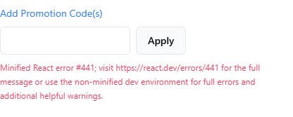

# BUG-E2E-005: Rejected cart and checkout actions show "Minified React error #441" in production builds

| Field        | Value                                                                                                                                |
| ------------ | ------------------------------------------------------------------------------------------------------------------------------------ |
| Severity     | **Major** — a core checkout interaction gives the shopper a meaningless technical error                                              |
| Priority     | **High** — every production deployment of the starter is affected; promo codes are typed by hand, so invalid codes are common        |
| Component    | Storefront (Next.js starter), `modules/checkout/components/discount-code`, server action `applyPromotions` in `lib/data/cart.ts`     |
| Environment  | Production build (`next build` + `next start`), Medusa 2.22.2; Chromium, Firefox and WebKit. See [findings](../findings.md#findings) |
| Related test | `tests/e2e/promotions.spec.ts` › "an unknown code shows a readable error and changes nothing [BUG-E2E-005]"                          |

## Preconditions

Storefront running as a production build; any item in the cart.

## Steps to reproduce

1. Add QA Mug to the cart, go to checkout.
2. Click "Add Promotion Code(s)", type `NOT-A-REAL-CODE`, click **Apply**.

## Expected

A readable error such as the API's own message: "The promotion code NOT-A-REAL-CODE is invalid." The
API returns exactly this text (`400 invalid_data`), and the component is written to display
`e.message` of the caught error.

## Actual

The error area shows: _"Minified React error #441; visit https://react.dev/errors/441 for the full message
or use the non-minified dev environment for full errors and additional helpful warnings."_
Totals are unchanged (correct).

## Same defect in other places (exploratory session S2)

| Action | Real reason from the API | Shown to the shopper |
|---|---|---|
| Apply an invalid promo code | "The promotion code … is invalid" | #441 |
| Set a cart quantity above stock | "Some variant does not have the required inventory" | #441 |
| Place an order whose item has just sold out | inventory error; no order is created (correct) | #441 |

See [session 2](../manual/exploratory/session-2-stock.md).

## Root cause (analysis)

`applyPromotions` is a Next.js **server action** that **throws** on an API error (`.catch(medusaError)`
re-throws). In production builds React replaces the message of errors thrown by server functions with
error #441 ("The specific message is omitted in production builds to avoid leaking sensitive
details"). The client component then shows that replaced message. In `next dev` the original message
survives, which is why the problem is invisible during development.

Suggested fix: return `{ error: message }` from the server action instead of throwing (the pattern the
starter already uses for login and address forms), and render that value.

## Impact

Shoppers cannot tell a mistyped code from a broken site; some abandon checkout. Support cannot help
from the message either.
