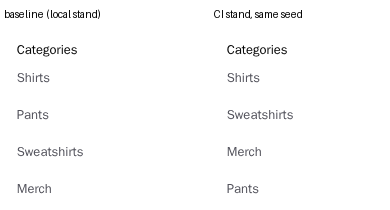

# BUG-E2E-009: Footer category order differs between installations with the same data

| Field | Value |
|---|---|
| Severity | **Trivial** — the same links are shown, only their order changes |
| Priority | **Low** |
| Component | Storefront, `modules/layout/templates/footer/index.tsx` and `lib/data/categories.ts` |
| Environment | Medusa 2.22.2 starter, production build; `shop-sut` v1.0.0 images; Playwright 1.64.1 Linux image (`mcr.microsoft.com/playwright:v1.64.1-noble`) |
| Found in | The first weekly visual run on GitHub Actions, 2026-11-02 |

## Steps to reproduce

1. Start two stands from the same `shop-sut` release with the same seed (here: one on Docker Desktop, one on a
   GitHub Actions runner).
2. Open the home page on both and compare the **Categories** column in the footer.

## Expected

The same order on every installation — the seed order or the categories' `rank`, which the seed sets.

## Actual

| Stand | Order |
|---|---|
| Local (the visual baseline) | Shirts, Pants, Sweatshirts, Merch |
| CI runner | Shirts, Sweatshirts, Merch, Pants |

The storefront requests `/store/product-categories` without an `order` parameter, and the route's list
configuration in `@medusajs/medusa` 2.22.2 (`api/store/product-categories/query-config.js`) sets no default
order, so the order is whatever the database returns. The four categories are created by one workflow call in
the seed. All three visual screenshots with a footer failed on exactly these 406 pixels; the checkout page,
which has no footer, passed.

## Impact

Shoppers see the navigation reshuffle between environments (and potentially after database maintenance);
any visual or content check of the footer is unstable. A fix is one query parameter (`order: "rank"`).

## How it is pinned

The visual tests mask `footer-categories` with a comment naming this finding. Nothing fails automatically when
it is fixed: an expected-failure test cannot be used, because on some installations the order happens to be
right and the test would pass by chance.
