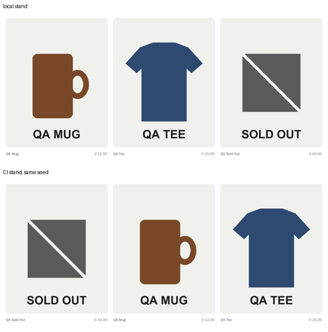
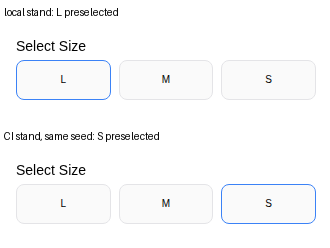

# BUG-E2E-009: Storefront order and default size depend on unordered API results

| Field | Value |
|---|---|
| Severity | **Minor** — the preselected size, which "Add to cart" uses without a choice, differs between installations; the reordered lists are cosmetic |
| Priority | **Low** |
| Component | Storefront: `modules/products/components/product-actions` (`getDefaultVariant`), `modules/home/components/featured-products/product-rail`, `modules/layout/templates/footer`, `lib/data/{products,categories}.ts` |
| Environment | Medusa 2.22.2 starter, production build; `shop-sut` v1.0.0 images; Playwright 1.64.1 Linux image (`mcr.microsoft.com/playwright:v1.64.1-noble`) |
| Found in | The first weekly visual run on GitHub Actions, 2026-11-02, and the two baseline update runs the same day |

## Steps to reproduce

1. Start two stands from the same `shop-sut` release with the same seed (here: one on Docker Desktop, three on
   GitHub Actions runners).
2. On each, open the home page and compare the **QA Picks** rail and the footer's **Categories** column.
3. Open `/dk/products/qa-tee` and look at which size is selected before any click.

## Expected

The same result on every installation: the rail in the collection's order, categories by their `rank`, and the
same default size (or none, so the shopper has to choose).

## Actual

| Stand | QA Picks rail | Footer categories | Size preselected on QA Tee |
|---|---|---|---|
| Local (the original visual baseline) | Mug, Tee, Sold Out | Shirts, Pants, Sweatshirts, Merch | L |
| CI, weekly run | Mug, Tee, Sold Out | Shirts, Sweatshirts, Merch, Pants | L |
| CI, first baseline update | Sold Out, Mug, Tee | (masked by then) | L |
| CI, second baseline update | (compared card by card by then) | (masked) | **S** |

The storefront requests `/store/products` and `/store/product-categories` without an `order` parameter, and
Medusa 2.22.2 sets no default: `get-query-config.js` in `@medusajs/framework` builds an order only from the
request, and the routes' list configurations define none. The order is therefore whatever the database
returns. The product page then preselects `product.variants.find(isVariantInStock) ?? product.variants[0]` —
the first in-stock variant in that same unordered list. The QA products, their variants and the starter's
categories are each created by one workflow call.

In the weekly run all three visual screens with a footer failed on exactly the 406 pixels of the category
list; the checkout page, which has no footer, passed.

## Impact

A shopper who presses "Add to cart" without choosing a size gets L on one installation and S on another, and
featured products and navigation reshuffle between environments. Any check that relies on position or on the
default selection is unstable. The fix is an explicit order in each query (for example `order: "rank"` for
categories, `variants.rank` or a fixed sort for variants).

## How it is pinned

`tests/visual/pages.spec.ts`, with a comment naming this finding: the footer category list is masked; the
home page is compared with the product cards masked and each card on its own, found by its title, with the
rail's columns made whole pixels wide for that screenshot (a card that moved to another column otherwise
differed at its anti-aliased edges — a fifth stand, from a clean clone on 2026-11-03, showed it); the product
page chooses size M before the screenshot. Nothing fails automatically when it is fixed: an expected-failure
test cannot be used, because on some installations the order happens to be right and the test would pass by
chance. The functional tests already choose a size explicitly, and the API tests' `variants[0]` is safe
because all three QA Tee sizes have the same price and stock.
