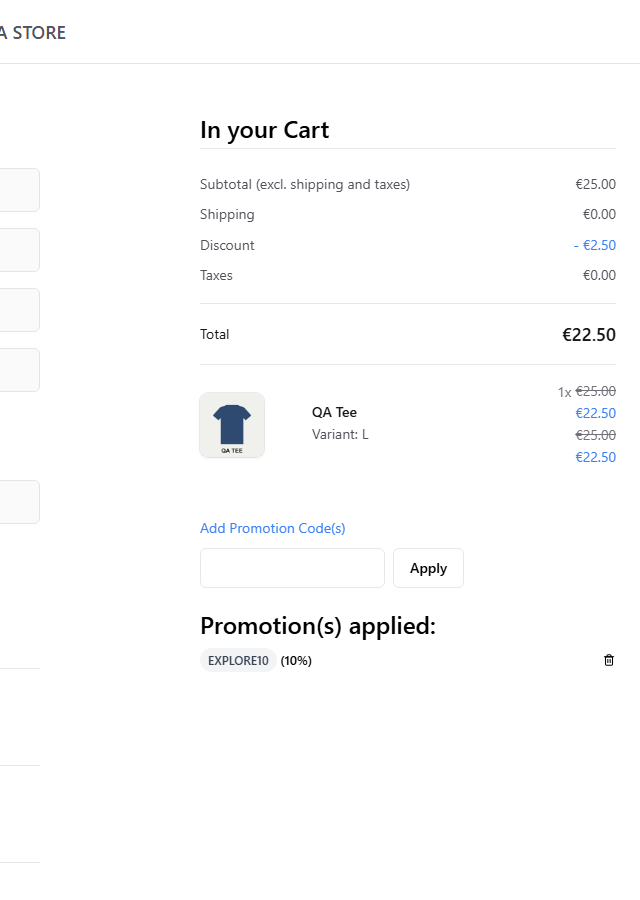
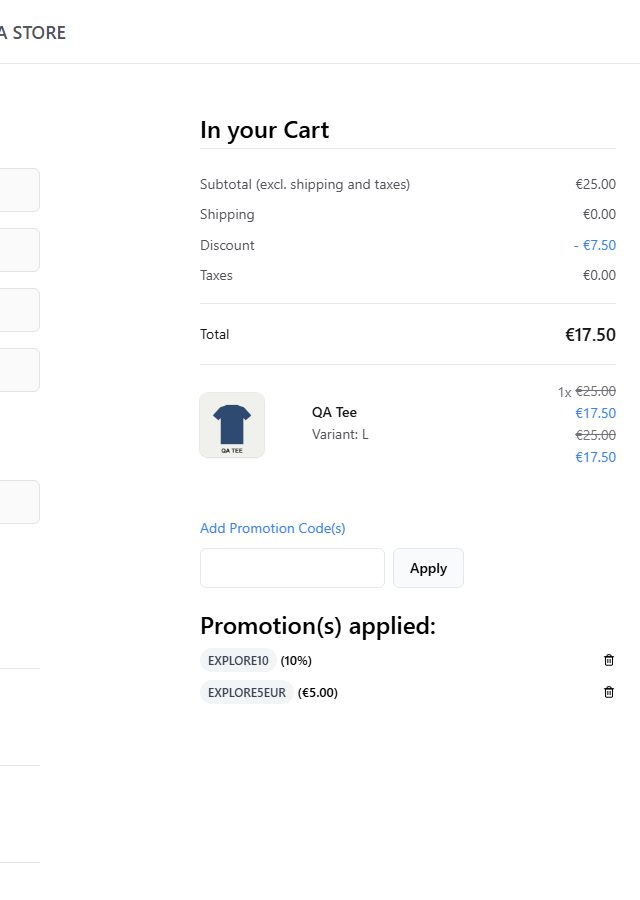

# S1 — Promo code input at checkout

| | |
|---|---|
| **Charter** | Explore the promo code field at checkout with valid, invalid and unusual inputs to discover validation and messaging problems |
| **Timebox** | 30 min (actual ~25) |
| **Areas** | Storefront › Checkout › Discount code; Store API promotions |
| **Setup** | Two active codes created through the Admin API for the session and deleted afterwards: `EXPLORE10` (10 % off order) and `EXPLORE5EUR` (5.00 EUR off order). Cart: 1 × QA Tee, total 25.00 EUR |
| **Task breakdown** | Setup 20 % · Testing 60 % · Bug investigation 20 % |

## Notes

| Probe | Input | Total after | Shown to the shopper |
|---|---|---|---|
| Lower case of a valid code | `explore10` | 25.00 (no discount) | "Minified React error #441 …" |
| Valid code with spaces around | `␠␠EXPLORE10␠␠` | 25.00 (no discount) | "Minified React error #441 …" |
| Valid code | `EXPLORE10` | 22.50 | Row "EXPLORE10 (10%)" with a remove control |
| Same code again | `EXPLORE10` | 22.50 (unchanged) | No message, nothing duplicated |
| Second valid code (stacking) | `EXPLORE5EUR` | 17.50 | Two rows: "EXPLORE10 (10%)", "EXPLORE5EUR (€5.00)" |
| 300 × `X` | `XXXX…` | 17.50 (unchanged) | "Minified React error #441 …" |
| HTML/script-like text | `` | 17.50 (unchanged) | "Minified React error #441 …"; no script executed, input rendered as text |

 

## Bugs

- **BUG-E2E-005** (already filed) — every rejected code shows the minified React error instead of the API
  message. The session showed it is not one bad input but every rejection path.

## Issues and questions for the product owner

1. **Case sensitivity.** `explore10` is rejected while `EXPLORE10` works. Most shops treat codes as
   case-insensitive because shoppers type them by hand. Intended?
2. **Whitespace.** A valid code pasted with surrounding spaces is rejected. Copy-paste from emails often
   adds spaces. Should the storefront (or the API) trim the input?

## Observations for test design

- Stacking is allowed by default: 10 % is applied first (25.00 → 22.50), then the fixed 5.00 (→ 17.50).
  The order of application matters for totals; the pricing oracle in the API suite should model it.
- Applying the same code twice is idempotent — a good regression check (covered by the API suite).
