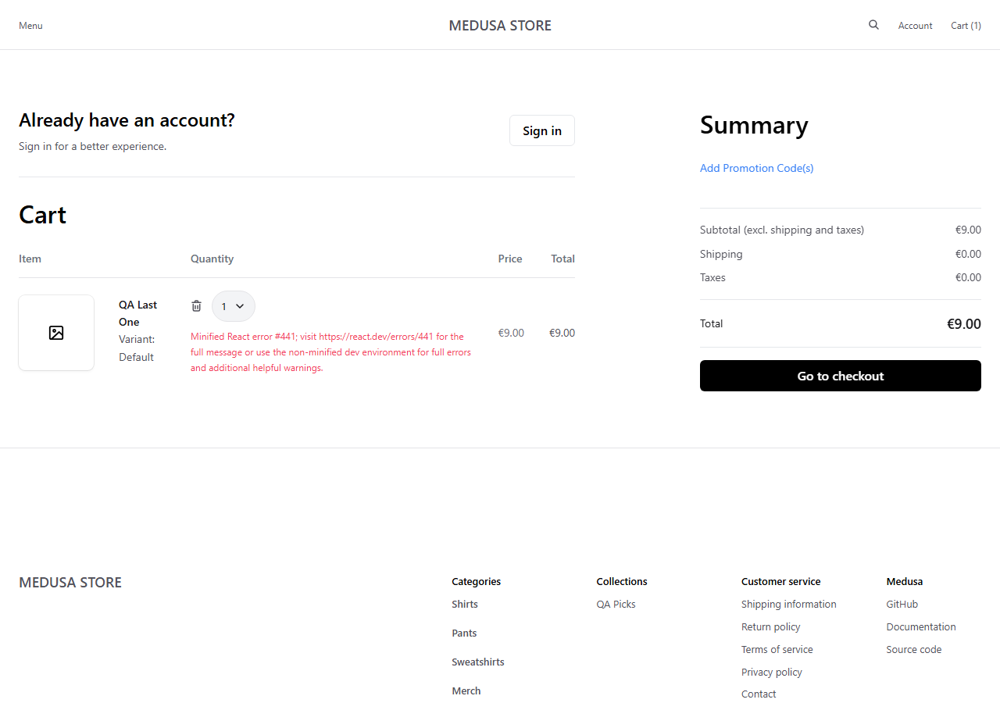
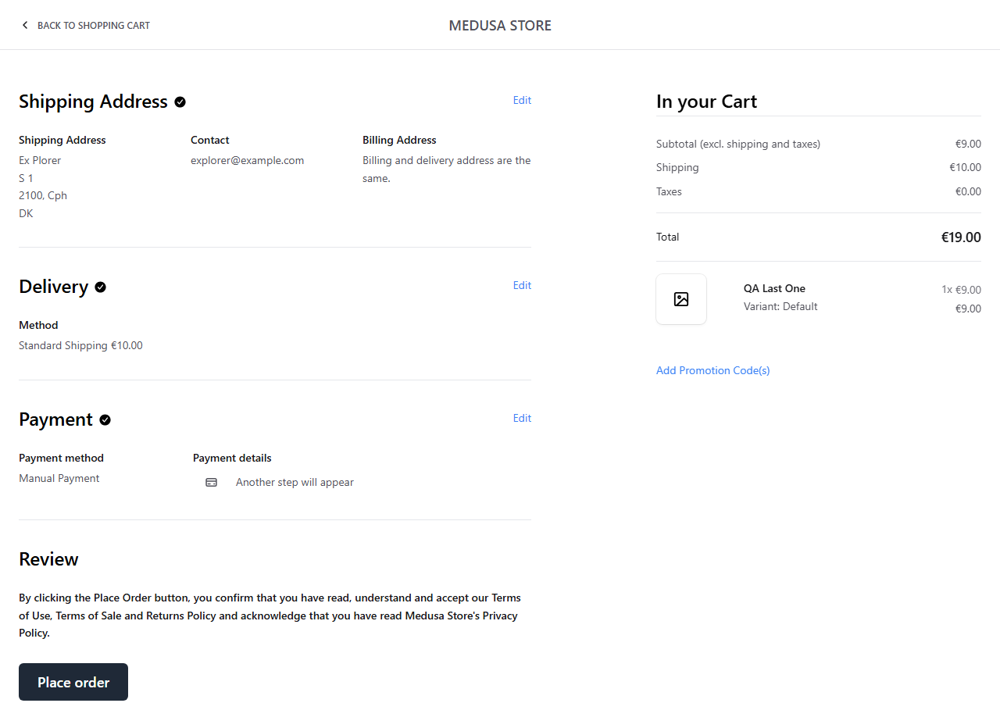

# S2 — Cart quantities against real stock, and the race for the last item

| | |
|---|---|
| **Charter** | Explore how the cart and checkout handle quantities above the available stock, and what a shopper sees when someone else buys the last item first |
| **Timebox** | 45 min (actual ~40) |
| **Areas** | Storefront › Product, Cart, Checkout review; inventory reservations |
| **Setup** | Product "QA Last One" (9.00 EUR, inventory managed) created through the Admin API with **stocked quantity 1** at the European Warehouse; deleted after the session |
| **Task breakdown** | Setup 25 % · Testing 50 % · Bug investigation 25 % |

## Notes

1. Product page shows "In stock" and "Add to cart"; adding 1 works, header shows "Cart (1)".
2. Cart quantity drop-down offers **Select…, 1, 2, … 10, 1** — ten quantities although only one is in
   stock, and a second "1" at the end.
3. Choosing **2**: the quantity stays 1 and the row shows "Minified React error #441 …".
   
4. A second shopper (Store API, separate cart) buys the last item: order created.
5. Back in the browser: address → delivery → manual payment → **Place order**. The page stays on the
   review step and shows "Minified React error #441 …". **No order is created** — overselling is
   prevented. Inventory after: stocked 1, reserved 1, available 0.
   

## Bugs

- **BUG-E2E-008** (new) — the cart quantity select ignores stock (always 1–10) and appends a duplicate "1".
- **BUG-E2E-005** (scope widened) — the same unreadable #441 error appears for a quantity above stock and
  for placing an order whose item has just sold out, not only for promo codes.

## Questions

1. When the last item sells out while it is in a cart, should the cart page warn the shopper before
   checkout (on page load), instead of failing at "Place order"?

## Good news worth keeping

Inventory reservation works: two shoppers racing for one item never produce two orders. This is a
regression candidate for the API suite (concurrency tests: one stock, two carts).
