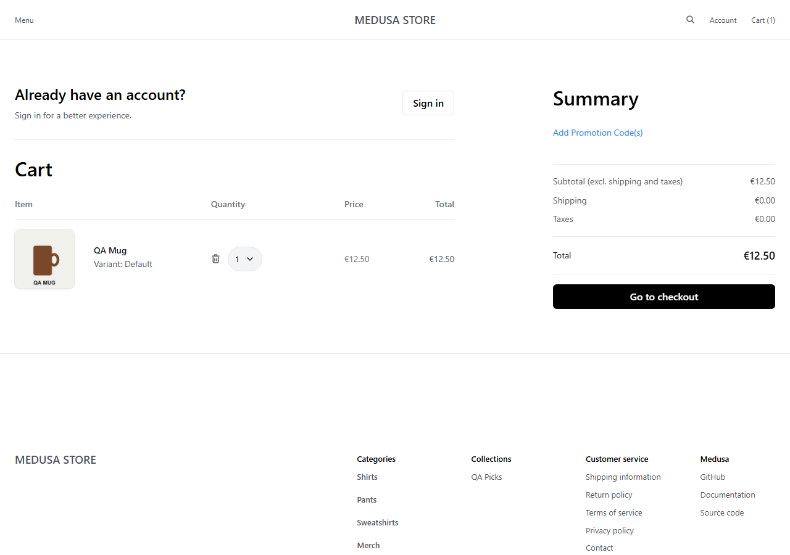
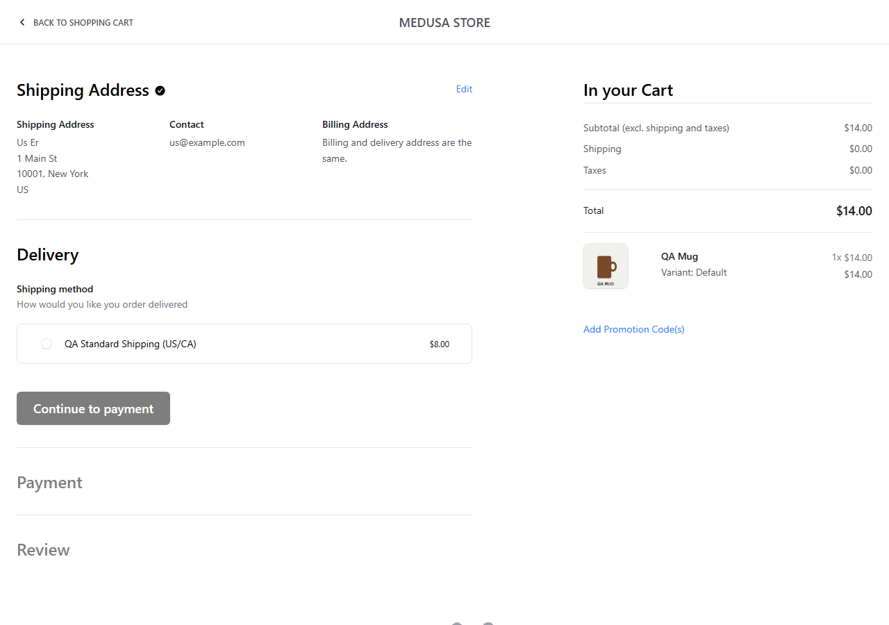

# S3 — Region and currency switching

| | |
|---|---|
| **Charter** | Explore switching between the Europe (EUR) and QA North America (USD) regions to discover currency, pricing and shipping inconsistencies |
| **Timebox** | 30 min (actual ~25) |
| **Areas** | Storefront › country selector, product prices, cart, checkout address and delivery |
| **Setup** | Seeded data only: QA Tee 25.00 EUR / 30.00 USD, QA Mug 12.50 EUR / 14.00 USD, Europe shipping 10 EUR, US/CA shipping 8 USD |
| **Task breakdown** | Setup 10 % · Testing 75 % · Notes 15 % |

## Notes

1. `/us/products/qa-tee` shows **$30.00** — correct USD price.
2. QA Mug added on `/dk` → cart total **€12.50**.
3. Typing `/us/cart` in the address bar with the same cart: still **€12.50** — the URL says US, the
   cart stays in the Europe region and EUR. 
4. Side menu → "Shipping to: Denmark" → **United States**: URL becomes `/us`, cart total **$14.00**
   (the USD price of QA Mug, not a converted EUR amount). 
5. Checkout address step offers only **Canada** and **United States** — the countries of the cart's region.
6. Delivery step offers one option: **QA Standard Shipping (US/CA) $8.00**. 

## Bugs

None found in this session.

## Questions

1. Should opening a country URL directly (`/us/...`) move an existing cart to that country's region, as
   the selector does? Today the page language says US while prices stay in EUR, which can confuse a
   shopper following a link from a US campaign.

## Observations for test design

- Prices per currency are explicit price-list values, not exchange-rate conversions — tests must take
  expected amounts from the product data, never compute them with a rate.
- The country list at checkout is driven by the cart's region: a good state-transition case
  (region switch → checkout countries change).
